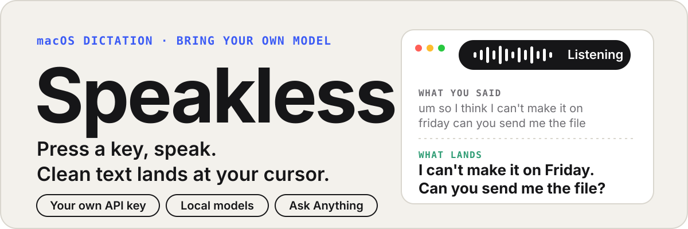
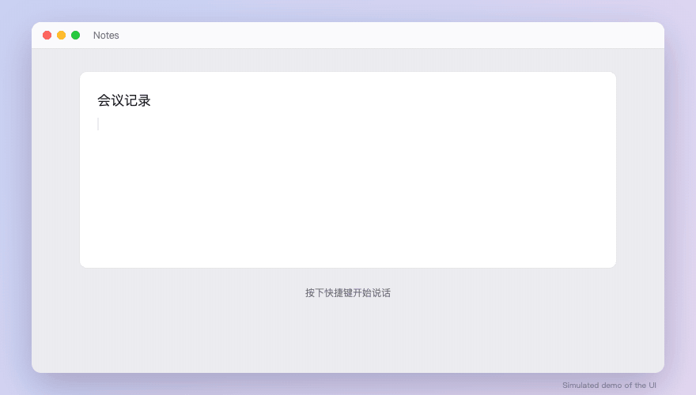
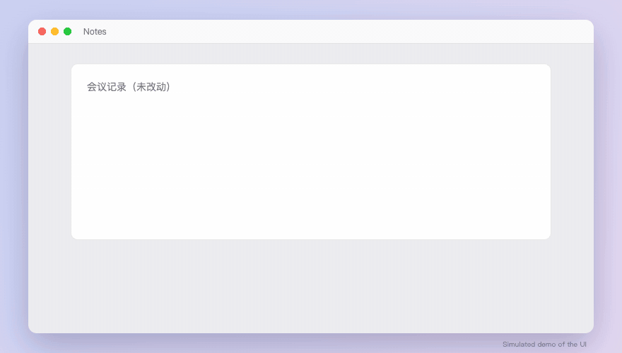
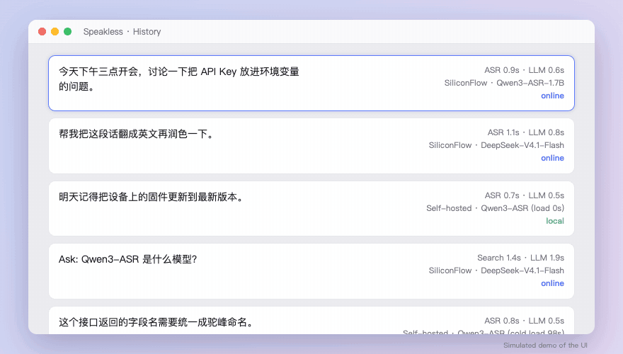
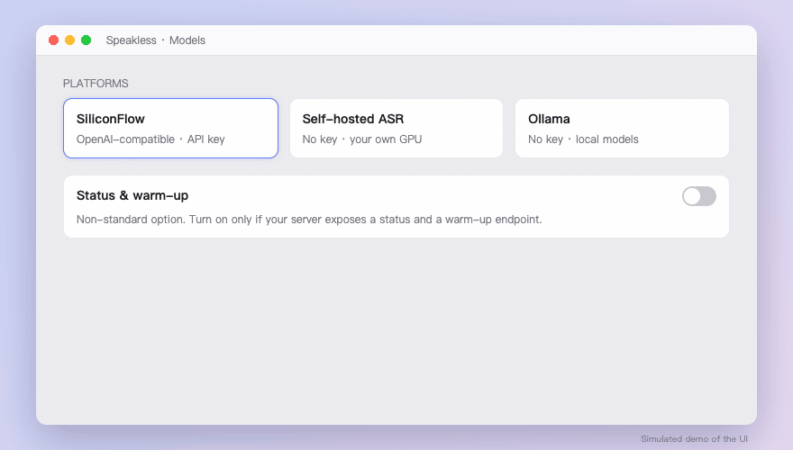
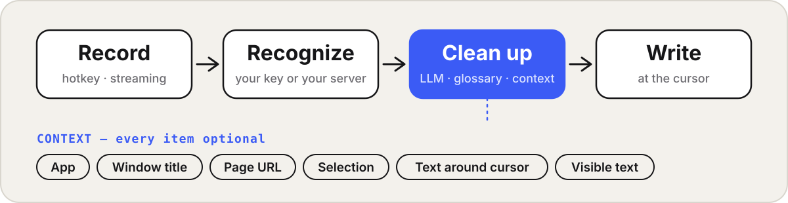
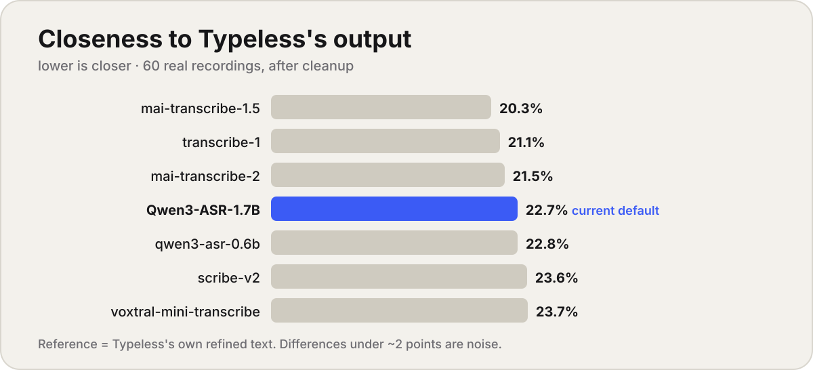

<p align="center"></p>

<p align="center">       </p>

<p align="center"><b>English</b> · <a href="README.zh-CN.md">简体中文</a> &nbsp;|&nbsp; <a href="#install">Install</a> · <a href="#how-it-works">How it works</a> · <a href="#benchmarks">Benchmarks</a> · <a href="docs/ARCHITECTURE.md">Docs</a></p>

<p align="center"> <br> </p>
<p align="center"><sub>Simulated UI demos (HTML animations, not real screen recordings); all text and data are samples.</sub></p>

Speakless is a native macOS dictation app: press a hotkey, speak, press again, and the transcribed, cleaned-up text is typed at your cursor. Written in Swift/SwiftUI; builds with just the Command Line Tools.

## How it works

<p align="center"></p>

## Features

- **Bring your own models.** Swap ASR and cleanup models in Settings → Models. Works with OpenAI-compatible APIs such as SiliconFlow, and with self-hosted or local servers.
- **Friendly to local models.** An opt-in "status & warm-up" option asks your own server to load its model as soon as you start recording; streaming segments make text appear right after you stop. The endpoint is non-standard, so it is off by default.
- **Chinese-first.** Prompts and glossary are tuned for Chinese and mixed Chinese/English dictation; a small reproducible benchmark lives in `tests/siliconflow/`.
- **Context-aware.** Optionally reads the front app, window title, page URL, selected text and text around the cursor. Every item can be switched off, and specific apps can be blocked.
- **Ask Anything.** A second hotkey asks a question and shows the answer in a floating box instead of editing your text, with optional web search and citations. Press the ask key mid-recording to switch modes.
- **History with timings.** Per-stage latency, provider, model and local/online for every dictation.
- Personal dictionary, auto-learning from your edits, custom hotkeys.

## Install

Download `Speakless-x.y.z-macos-arm64.zip` from [Releases](../../releases), unzip, and move it to Applications. Requires macOS 13+; the prebuilt package is Apple Silicon (arm64) only, so Intel Macs should build from source.
The build is not notarized yet: the first time, right-click → Open (or run `xattr -dr com.apple.quarantine /Applications/Speakless.app`).

Or build from source (Command Line Tools only, no full Xcode):

```bash
git clone https://github.com/StarryGuli/speakless.git
cd speakless/app
./build.sh --install
```

## Quick start

1. Settings → Models: pick a platform and paste your own API key (stored locally), then Test connection. To use your own server, add a no-key platform with its base URL.
2. On Home → Setup, grant Microphone, Input Monitoring and Accessibility.
3. If you use Fn as the hotkey: System Settings → Keyboard → "Press 🌐 key to" → Do nothing.
4. In any text field press the hotkey to start, press again to finish; the text lands at the cursor.

## Usage

| To… | Do this |
|---|---|
| Dictate | Default Fn (Settings → Shortcuts: a single modifier or a 2–3 key combo) |
| Ask a question | Default Fn+Space. The answer shows in a floating box and does not touch your text; "Insert at cursor" is optional |
| Switch a dictation into a question | Press the ask key while recording |
| Add terms | Add them in Dictionary; words you correct after dictating are learned automatically |
| See timings | History shows per-stage time, provider, model and local/online on the right of each entry |

## Providers and models

| Type | Notes |
|---|---|
| SiliconFlow | Default online platform. Defaults: Qwen3-ASR-1.7B for ASR, DeepSeek-V4.1-Flash for cleanup (changeable) |
| Other OpenAI-compatible services | Base URL + key |
| Self-hosted ASR / Ollama | No key; treated as a local model, with keep-alive and load-allowance settings |
| Status & warm-up (optional) | Turn on only if your server exposes endpoints like `/health` and `/warmup`; it loads the model while you start speaking. Non-standard, off by default |

## Context

Cleanup and Ask can include: front app and window title, page title and URL, input field type, selected text, text before/after the cursor, and visible screen text. All items are on by default, each can be turned off, and apps can be blocked. The prompt tells the model to treat context as reference only and never copy it into the output.

## Benchmarks

How close is each speech-recognition model to Typeless's output? 60 real recordings (868 s) from the author's own Typeless library; the reference is Typeless's own refined text, so lower means *more similar to Typeless* (character error rate). Small sample: differences under ~2 points are noise.

<p align="center"></p>

Takeaways: the current default is already among the best; switching ASR gains only ~2 points; most of the remaining gap is Typeless's rewriting style, not recognition. Prompt tuning toward more rewriting did not help. Full tables, method, caveats and scripts: [docs/BENCHMARKS.md](docs/BENCHMARKS.md). Recordings and transcripts are not published.

## Project layout

```
app/Sources/Speakless/   app source (SwiftUI + AppKit)
app/build.sh             builds the .app bundle
tests/siliconflow/       model benchmark scripts and a results summary
docs/                    architecture, development notes, changelog, demo animations
```

See [Architecture](docs/ARCHITECTURE.md), [Development](docs/DEVELOPMENT.md), [Contributing](CONTRIBUTING.md) and the [Changelog](docs/CHANGELOG.md).

## FAQ

- **Fn opens the emoji picker** – see Quick start step 3.
- **Permissions reset after each rebuild** – sign with a local self-signed certificate named "Speakless Local Signing" (see DEVELOPMENT.md).
- **⌘+Space does nothing** – that is Spotlight's shortcut; choose another combo for Ask.
- **First transcription on my own server is slow** – the model is cold-loading; enable Status & warm-up so it loads as soon as you start speaking.

## Roadmap (planned, no dates)

Per-app output styles, translation mode, edit-selection by voice, hold-to-talk, dictionary import/export, notarized builds.

## Privacy

- No server of our own and no telemetry.
- Audio and text go only to the recognition and cleanup providers you configure.
- Context (window title, screen text, …) is sent to your configured provider along with cleanup requests; turn items off in Settings → Context.
- Web search (Ask Anything) sends the query to Bing / DuckDuckGo.

## Status and license

Early release, tested on macOS only. Issues and PRs welcome. MIT licensed, see [LICENSE](LICENSE).
